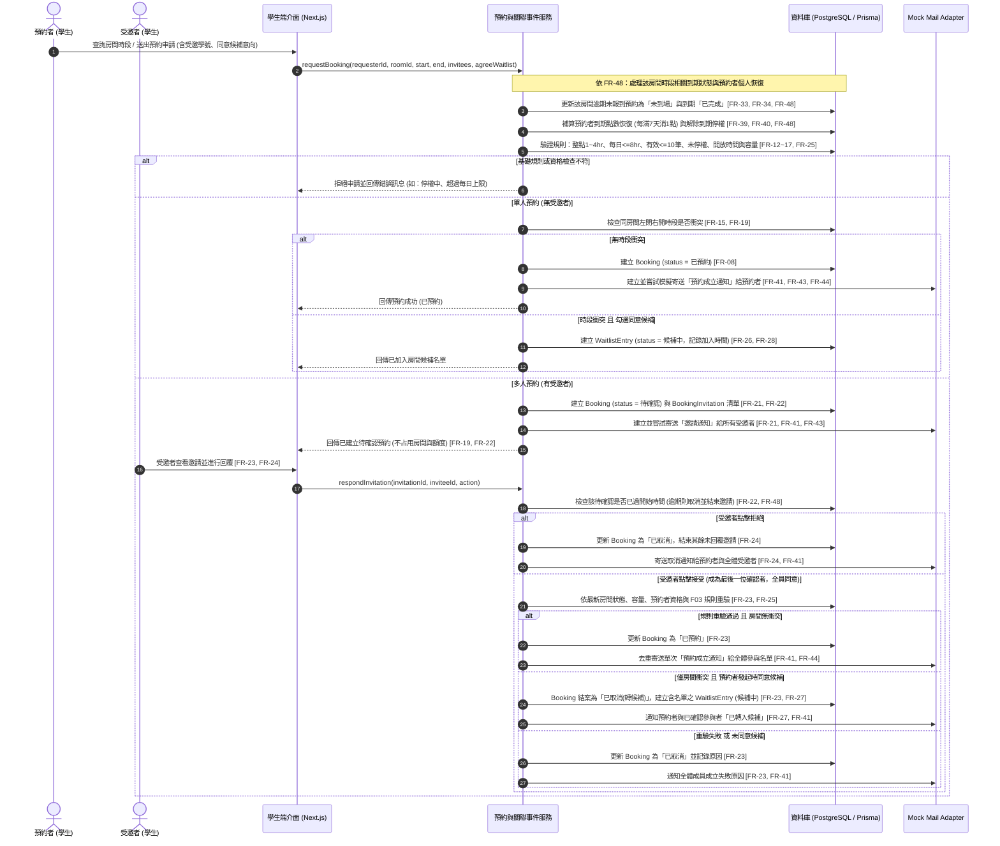
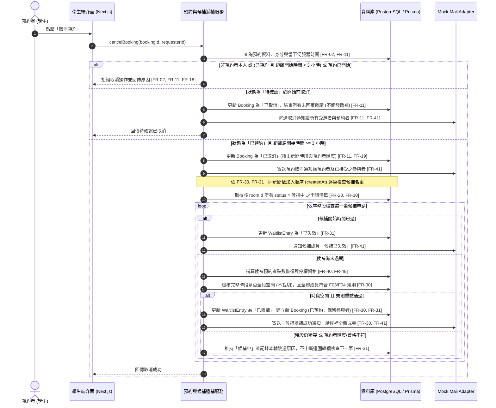
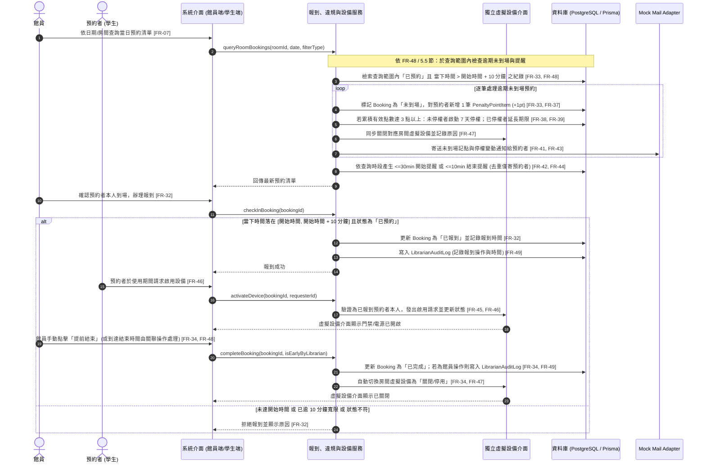

# 瀑布組 UML 循序圖（Sequence Diagram）

> 依據 `waterfall/SRS.md` 階段二建模規範，系統循序圖涵蓋「預約與多人邀請／候補」、「取消預約與自動遞補」以及「館員報到、未到場記點與虛擬設備控制」三大業務流程。所有流程皆嚴格落實無背景排程（FR-48）之被動關聯觸發機制與 Mock Mail 去重規則（FR-44）。

---

## 1. 預約與多人邀請／候補循序圖

* **對應需求**：FR-08、FR-12～19、FR-21～28、FR-41、FR-43、FR-44、FR-48
* **說明**：涵蓋單人直接預約、多人邀請待確認轉成立，以及時段衝突轉入候補名單的完整判定路徑。

---

## 2. 取消預約與候補自動遞補循序圖

* **對應需求**：FR-02、FR-11、FR-18、FR-19、FR-30、FR-31、FR-41、FR-43、FR-44、FR-48
* **說明**：展現學生取消預約時的 3 小時期限檢核，以及已預約取消時觸發同房間多筆候補之循序無裁切遞補流程。

---

## 3. 館員報到、未到場記點與虛擬設備控制循序圖

* **對應需求**：FR-07、FR-32～40、FR-42、FR-45～49
* **說明**：展示館員查詢時被動觸發未到場判定（逾開始 10 分鐘記 1 點）、開始/結束通知提醒、預約者啟用虛擬設備，以及提前結束或到期之設備關閉與館員操作稽核。

